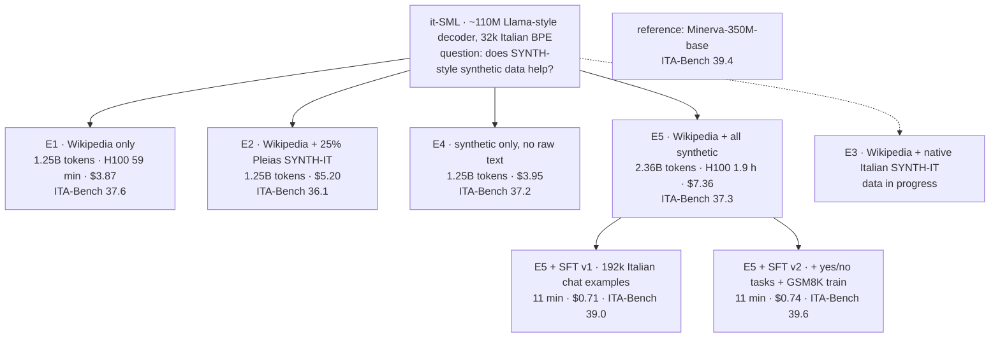

# ITA-Bench audit: what small Italian models really score

We trained six small Italian language models (~110M parameters) and evaluated them on [ITA-Bench](https://github.com/SapienzaNLP/ita-bench), the reference benchmark suite for Italian, together with the public [Minerva-350M-base](https://huggingface.co/sapienzanlp/Minerva-350M-base-v1.0). At this scale, several ITA-Bench tasks reward things other than understanding. This repo documents what we found, with numbers and scripts to reproduce them.

**Three findings, each reproducible without a GPU:**

| | Without a model | What it means |
|---|---|---|
| **TruthfulQA mc1** | Chance is **45.2%** under the official scoring, not 22.6% | A target bug counts two options as correct. Every model gains ~30 points. |
| **GSM8K-IT (multiple choice)** | "Pick the median number" scores **89.5%** | Distractors are gold ±1, ±2. The task mostly measures a prior over numbers. |
| **BoolQ** | "Always answer *Sì*" scores **62.2%** | Many small models sit right at this baseline. A score near 62 says nothing about reading. |

ARC-Challenge is at chance (25%) for every model up to 350M parameters that we tested.

None of this is a criticism of the people behind ITA-Bench, who made Italian evaluation possible in the first place. The TruthfulQA issue is a one-line fix, and we have reported both points upstream: <ISSUE_URL>.

---

## Finding 1: TruthfulQA mc1 scores a label vector as a set of indices

[`tasks/translations/truthful_qa/utils.py#L43`](https://github.com/SapienzaNLP/ita-bench/blob/c1d077f5af6670985ec797555fa949dba6ecf121/tasks/translations/truthful_qa/utils.py#L43) sets `"gold": doc["label"]["mc1"]`, a vector like `[1, 0, 0, 0]`. lm-eval reads a list target as the set of correct **indices** ([`task.py#L1529-L1530`](https://github.com/EleutherAI/lm-evaluation-harness/blob/v0.4.8/lm_eval/api/task.py#L1529-L1530)), i.e. {0, 1}. Picking option 0 **or** option 1 is scored as correct.

| Model | Official target | Correct target | Gap |
|---|---|---|---|
| Minerva-350M-base | 60.2 | 30.8 | +29.4 |
| it-SML E1: Wikipedia only | 58.1 | 26.6 | +31.4 |
| it-SML E2: Wikipedia + 25% Pleias SYNTH-IT | 59.2 | 28.7 | +30.5 |
| it-SML E4: synthetic only | 59.5 | 29.5 | +30.0 |
| it-SML E5: Wikipedia + all synthetic | 62.2 | 31.6 | +30.6 |
| it-SML E5 + SFT v1 | 63.8 | 32.8 | +30.9 |
| it-SML E5 + SFT v2 | 64.0 | 33.0 | +31.1 |

Chance with the correct target is 22.6%. Corrected, most of these models are within a few points of chance.

## Finding 2: GSM8K-IT multiple choice is answerable without the question

- In 1,180 of the 1,319 test questions (89.5%), the four distractors are exactly gold −2, −1, +1, +2. "Pick the median number" therefore gets **89.5%** without reading anything.
- The official code also puts the gold at index 0 for every question ([`gsm8k/utils.py#L41`](https://github.com/SapienzaNLP/ita-bench/blob/c1d077f5af6670985ec797555fa949dba6ecf121/tasks/translations/gsm8k/utils.py#L41)). With log-likelihood scoring, position matters only on ties, where `argmax` picks index 0, i.e. the gold. A model that scores every option the same gets 100%. It also matters for anyone who turns the task into a lettered (A–E) prompt without shuffling.
- **Removing the question** (the model scores the five numbers alone): Minerva-350M still gets **42.1** against 47.9 with the question. Our models get 21–38 without the question and 43–50 with it.
- The generative version (exact match on the final number, 1,319 problems) is **at most 2.6%** for every model here, Minerva included. Answering "one of the numbers in the question" already gets 6.1%.

At ~100-350M parameters, GSM8K-MC measures a prior over numbers, not arithmetic.

## Finding 3: report the baselines next to the score

- **BoolQ:** 62.2% of the answers are *Sì*. Our Wikipedia-only model scores 62.2 exactly because it always answers *Sì*. For our best base and SFT models, the Sì/No log-probability margin separates true from false answers with an AUC of 0.49–0.52, i.e. no signal, even though they score 56–61.
- **ARC-C:** all models score 23–25 (chance 25; ±2.5 points is noise on 1,132 questions).
- **HellaSwag:** the one task where every model clearly beats its own no-question baseline (+3.7 to +4.9 points).

---

## Our protocol

`harness.py` runs the official task definitions (pinned commit, lm-eval 0.4.8, zero-shot) in three ways:

1. **official:** unchanged.
2. **corrected (main numbers):** options shuffled per question with seeds 0, 1, 2 (mean reported), so ties can't favour the gold position; TruthfulQA mc1 target replaced by the index of the correct answer.
3. **no question:** like 2, but the question/passage is removed. This measures what the answer options alone are worth.

Metrics: `acc_norm` for ARC-C and HellaSwag, `acc` for the rest.

## Full results

ITA-Bench zero-shot, one table per protocol. Generated by `make_tables.py` from `results/models/`.

#### Official protocol

| Model | ARC-C | HellaSwag | BoolQ | TruthfulQA mc1 | GSM8K-MC | Mean |
|---|---|---|---|---|---|---|
| Minerva-350M-base (public) | 24.6 | 32.7 | 60.7 | 60.2 | 48.0 | 45.2 |
| it-SML E1: Wikipedia only | 23.1 | 29.3 | 62.2 | 58.1 | 47.2 | 44.0 |
| it-SML E2: Wikipedia + 25% Pleias SYNTH-IT | 23.2 | 29.5 | 51.4 | 59.2 | 48.7 | 42.4 |
| it-SML E4: synthetic only | 22.8 | 29.5 | 60.9 | 59.5 | 44.3 | 43.4 |
| it-SML E5: Wikipedia + all synthetic | 25.0 | 30.1 | 56.6 | 62.2 | 44.4 | 43.7 |
| it-SML E5 + SFT v1 | 24.6 | 30.6 | 60.9 | 63.8 | 46.8 | 45.3 |
| it-SML E5 + SFT v2 (saw GSM8K train) | 25.2 | 30.8 | 59.5 | 64.0 | 49.7 | 45.8 |

#### Corrected protocol (main numbers)

| Model | ARC-C | HellaSwag | BoolQ | TruthfulQA mc1 | GSM8K-MC | Mean |
|---|---|---|---|---|---|---|
| Minerva-350M-base (public) | 24.7 | 32.7 | 60.6 | 30.8 | 47.9 | 39.4 |
| it-SML E1: Wikipedia only | 23.2 | 29.3 | 62.1 | 26.6 | 46.8 | 37.6 |
| it-SML E2: Wikipedia + 25% Pleias SYNTH-IT | 23.2 | 29.5 | 51.2 | 28.7 | 48.0 | 36.1 |
| it-SML E4: synthetic only | 22.8 | 29.5 | 60.8 | 29.5 | 43.4 | 37.2 |
| it-SML E5: Wikipedia + all synthetic | 25.1 | 30.1 | 56.4 | 31.6 | 43.3 | 37.3 |
| it-SML E5 + SFT v1 | 24.7 | 30.6 | 60.9 | 32.8 | 46.2 | 39.0 |
| it-SML E5 + SFT v2 (saw GSM8K train) | 25.2 | 30.8 | 59.5 | 33.0 | 49.5 | 39.6 |

#### Question removed (seed 0)

| Model | ARC-C | HellaSwag | BoolQ | TruthfulQA mc1 | GSM8K-MC | Mean |
|---|---|---|---|---|---|---|
| Minerva-350M-base (public) | 26.3 | 27.8 | 37.8 | 27.5 | 42.1 | – |
| it-SML E1: Wikipedia only | 25.7 | 25.6 | 37.8 | 26.5 | 30.0 | – |
| it-SML E2: Wikipedia + 25% Pleias SYNTH-IT | 26.0 | 25.3 | 37.8 | 28.2 | 30.4 | – |
| it-SML E4: synthetic only | 27.4 | 25.2 | 62.2 | 28.5 | 38.2 | – |
| it-SML E5: Wikipedia + all synthetic | 26.6 | 25.7 | 37.8 | 27.4 | 27.1 | – |
| it-SML E5 + SFT v1 | 25.2 | 26.3 | 37.8 | 26.9 | 21.0 | – |
| it-SML E5 + SFT v2 (saw GSM8K train) | 25.9 | 26.2 | 37.8 | 28.3 | 21.8 | – |

## The experiments behind this

These findings came out of it-SML, a project that trains Italian-only decoders from scratch to test whether synthetic data built with the [SYNTH](https://huggingface.co/datasets/PleIAs/SYNTH) pipeline helps a small model. Each run is a node in our Flywheel lab notebook:



ITA-Bench numbers in the graph are the corrected-protocol means.

| Run | Pretraining data | Tokens | Cost* | Wikinews BPB ↓ | GSM8K solution BPB ↓ |
|---|---|---|---|---|---|
| E1 | Italian Wikipedia | 1.25B | $3.87 | 1.090 | 1.357 |
| E2 | Wikipedia + 25% Pleias SYNTH (Italian subset) | 1.25B | $5.20 | 1.094 | 1.328 |
| E4 | Pleias SYNTH (Italian subset) + 2% native, no Wikipedia | 1.25B | $3.95 | 1.365 | 1.314 |
| E5 | Wikipedia + all synthetic (~47%) | 2.36B | $7.36 | **1.050** | 1.179 |
| E5 + SFT v1 | + 192k Italian chat examples | – | +$0.71 | 1.232 | **0.970** |
| Minerva-350M-base | 70B tokens, Italian + English | – | – | 0.887 | 1.063 |

\*H100 on Modal at list price. All pretraining and SFT together cost about $24 including evaluations. BPB = bits per byte on held-out text (Wikinews 2024–26) and on the gold GSM8K solutions; differences between our runs are significant under a paired bootstrap.

**What the runs say (short version):**
- The Italian subset of Pleias SYNTH is seeded from **English** Wikipedia, with English reasoning traces. At 25% of the mix (E2) it doesn't move ITA-Bench.
- Synthetic data alone (E4) ties Wikipedia on ITA-Bench but is much worse at modelling real prose (+0.27 BPB on news).
- Wikipedia + synthetic (E5) is the best base model we measured, better on news text **and** on math solutions. Caveat: E5 saw ~2× the tokens of E1, and the equal-token control has not been run yet.
- At 110M, no model solves GSM8K. They learn the *form* of a solution, not the arithmetic.

Our checkpoints are not public yet, so the it-SML rows can be checked only through the raw JSON files in `results/models/`. The audit and the Minerva rows are fully reproducible from this repo.

---

## Reproduce

Tested on macOS with Python 3.11. Minerva requires accepting its terms on Hugging Face (`huggingface-cli login`).

```bash
./setup.sh                                   # clones ita-bench at c1d077f, installs lm-eval 0.4.8 in .venv
.venv/bin/python audit_itabench.py > results/audit.json        # findings 1-3 without a model, ~1 min + download

# Minerva-350M, three protocols (a free Colab T4 takes ~25 min in total)
M=sapienzanlp/Minerva-350M-base-v1.0
.venv/bin/python harness.py --model $M --official           --out results/models/minerva-350m_official.json
.venv/bin/python harness.py --model $M                      --out results/models/minerva-350m_shuffled.json
.venv/bin/python harness.py --model $M --no-context --seeds 0 --out results/models/minerva-350m_no_context.json

.venv/bin/python make_tables.py              # rebuilds the tables and results/*.csv
```

| File | Content |
|---|---|
| `audit_itabench.py` | model-free audit: chance, majority, gold positions, GSM8K distractor pattern, median heuristic |
| `harness.py` | three-protocol evaluation on the official task definitions |
| `make_tables.py` | tables and CSVs from the JSON results |
| `results/audit.json` | audit output |
| `results/models/*.json` | raw results per model and protocol, including per-seed scores and standard errors |
| `results/summary.csv`, `results/chart_data.csv` | flat tables |

## License and credits

Code: Apache 2.0. ITA-Bench task definitions are by [SapienzaNLP](https://github.com/SapienzaNLP/ita-bench) (Apache 2.0) and are fetched at a pinned commit, not redistributed. The datasets keep their own licenses. If you use ITA-Bench, please cite its authors.
